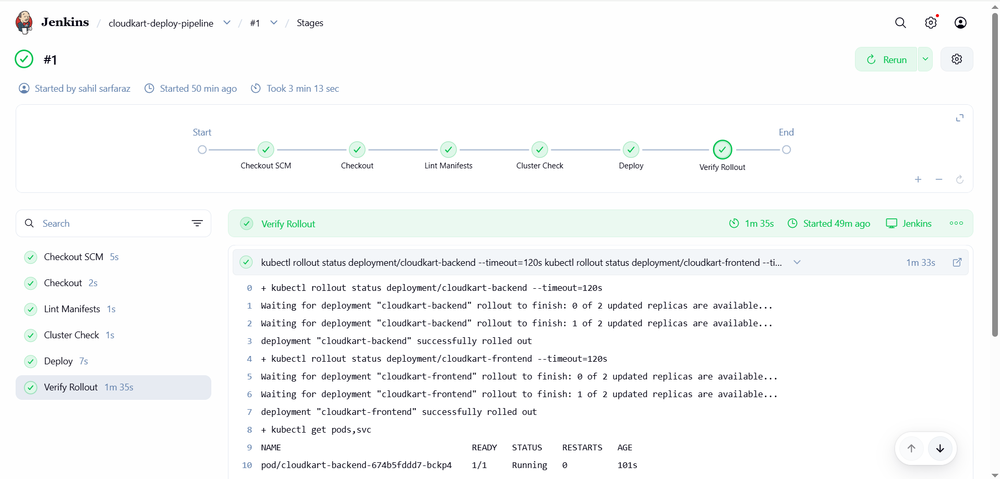
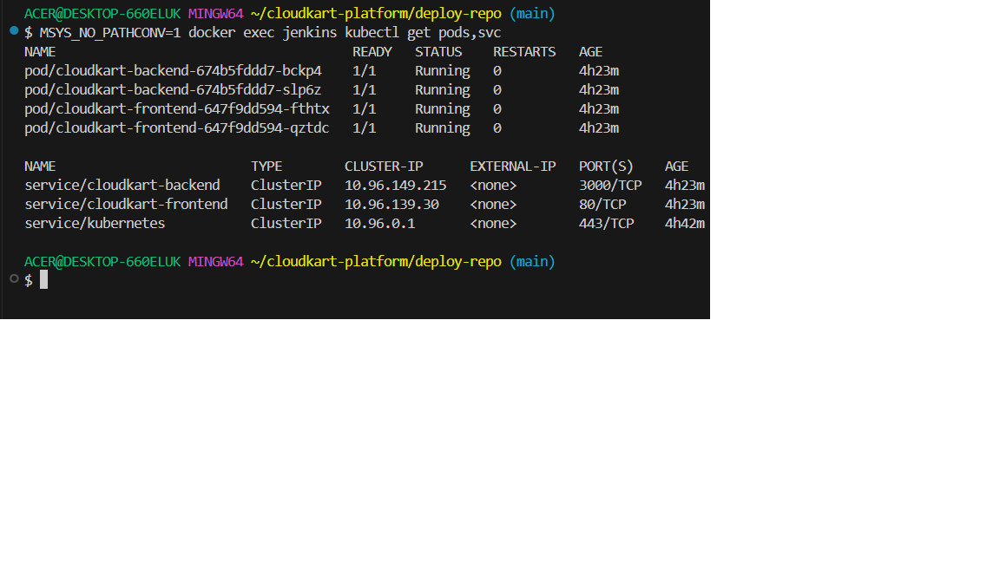

# CloudKart Deploy

Kubernetes manifests and a Jenkins pipeline that deploy the CloudKart app to a Kind cluster.

## What gets deployed
- Backend deployment (2 replicas) and ClusterIP service on port 3000
- Frontend deployment (2 replicas) and ClusterIP service on port 80
- Images are pulled from Docker Hub

## Deploy pipeline (Jenkins)
- Checkout
- Lint manifests (kubectl apply --dry-run)
- Cluster check
- Deploy (kubectl apply)
- Verify rollout (kubectl rollout status)

## Tech
Kubernetes, Kind, kubectl, Jenkins

## Screenshots

## Related repos
- cloudkart-app: application and CI pipeline
- cloudkart-infra: Terraform and the infrastructure pipeline
